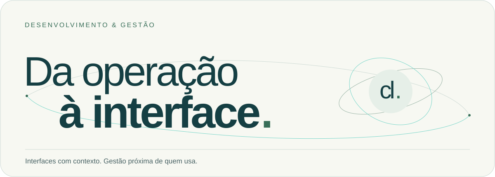

<picture>
  <source media="(prefers-color-scheme: dark)" srcset="./assets/hero-dark.svg" />
  <source media="(prefers-color-scheme: light)" srcset="./assets/hero-light.svg" />
  
</picture>

<h1 align="center">Carlos Henrique Lopes</h1>

<p align="center">
  <strong>Desenvolvimento &amp; Gestão</strong><br />
  Front-end · Power Platform · Dados · Gestão de equipes e processos<br />
  <sub>Recife, PE · Brasil · Também conhecido como Sk8 por aqui</sub>
</p>

<p align="center">
  <a href="https://portfoliocarloslopes.netlify.app/"></a>
  <a href="https://www.linkedin.com/in/carlos-lopes-b445aa201/"></a>
  <a href="mailto:carloshcldev@gmail.com"></a>
</p>

## Sobre mim

Construo ferramentas com a visão de quem já esteve na linha de frente. Minha trajetória começou na gestão de operações e na educação corporativa. Nos Correios, liderei equipes, acompanhei indicadores e atuei na gestão da rede franqueada. Essa experiência orienta como leio processos e organizo prioridades antes de desenhar uma interface.

Hoje, desenvolvo em React e Power Apps e conduzo o trabalho de agentes de IA com requisitos, revisão técnica e responsabilidade pelas decisões. Também ajudo equipes a compreender os dados e a usar as ferramentas com autonomia. Gosto de fazer áreas diferentes conversarem entre si e de transformar informação dispersa em algo útil para quem precisa decidir.

```javascript
const carlos = {
  nome: "Carlos Henrique Lopes",
  base: "Recife, PE",
  formacao: [
    "Gestão da Tecnologia da Informação",
    "Especialização em Desenvolvimento Mobile"
  ],
  atuacao: {
    gestao: ["Equipes", "Processos", "Scrum", "Educação corporativa"],
    interfaces: ["React", "TypeScript", "Power Apps", "UX/UI"],
    dados: ["Excel", "Power BI", "Lists", "SharePoint"]
  },
  iaAplicada: ["Harness", "SDD", "Contexto", "Revisão humana"],
  pontoDePartida: "Entender a rotina de quem vai usar a solução"
};
```

## Tech Stack & competências

### Front-end


### Design & prototipação


### Dados & Microsoft Power Platform


### Gestão, ferramentas & IA aplicada


No desenvolvimento assistido por IA, trabalho com contexto, limites de execução e critérios de aceitação. Uso o SDD, desenvolvimento orientado por especificações, para dar direção ao trabalho dos agentes e revisar o que foi construído.

## Projetos em destaque

### 01 / JBL Desk

**Front-end, UX/UI e storytelling em Power Apps.** Interface corporativa para a JBL Nordeste durante sua transição digital, construída em colaboração com Product Owner e equipe de back-end. Foi meu primeiro trabalho conduzindo agentes de IA na construção, com Gemini.

Os números apresentados no case são fictícios: a base foi criada para trabalhar a interface e sua narrativa, sem representar resultados reais do negócio.

[Conheça o case no portfólio →](https://portfoliocarloslopes.netlify.app/#jbl-desk)

### 02 / GERAT APP

**Front-end e atuação como agilista.** Aplicação local nos Correios que concentrava e tratava dados de sistemas dispersos para apoiar os gestores das unidades. Trabalhei em uma equipe de três pessoas, com PO e desenvolvedor de back-end, usando Power Apps, Lists, SharePoint, Power Automate, Access e Excel.

O projeto recebeu o **Prêmio Destaques do Ano 2022**, na categoria Projeto de Inovação, entregue em 2023. A solução tornou-se um MVP em evolução para uma aplicação oficial em outra linguagem.

[Conheça o case →](https://portfoliocarloslopes.netlify.app/#gerat-app) · [Veja o reconhecimento no LinkedIn →](https://www.linkedin.com/feed/update/urn:li:activity:7135630836141309952/)

### 03 / Michely Massoterapia

**Site para uma cliente do setor de serviços.** Desenvolvimento da interface e da navegação responsiva, com apresentação dos serviços e caminhos diretos para contato e agendamento.

`React` `Tailwind CSS` `Vite` `JotForm`

[Acesse o site →](https://michelymassoterapia.netlify.app/) · [Explore o código →](https://github.com/CHCLopes/ProjetoMassoterapia)

### 04 / Endereçador

**Uma ferramenta que nasceu da rotina de postagem.** Consulta de CEP, preenchimento de endereços, prévia dos documentos e fila de impressão em um só fluxo.

`React` `TypeScript` `Tailwind CSS` `ViaCEP`

[Experimente →](https://enderecador.netlify.app/) · [Explore o código →](https://github.com/CHCLopes/Projeto-Enderecador)

### 05 / MyAntigravityHarness

**Direção e limites para o trabalho de agentes.** Estrutura de governança com especificações de produto, arquitetura e design system, roteamento de skills e scripts de execução e validação em Python.

`Python` `SDD` `Governança de IA`

[Explore o harness →](https://github.com/CHCLopes/MyAntigravityHarness)

<details>
<summary><strong>Outros projetos, estudos e bastidores</strong></summary>

- [Portfólio](https://github.com/CHCLopes/Portfolio): React, TypeScript e um processo de construção com decisões de produto, refinamentos de interface, acessibilidade e SEO. [Veja o resultado](https://portfoliocarloslopes.netlify.app/).
- [Sk8-Genius](https://github.com/CHCLopes/Sk8-Genius): jogo de memória em React e TypeScript, com modos de jogo, áudio e atalhos de teclado. [Experimente](https://sk8-genius.netlify.app/).
- [Bikcraft](https://github.com/CHCLopes/LandingPageBikCraft): estudo de HTML, CSS e mobile first a partir de um layout da Origamid. [Acesse a página](https://sk8bikcraft.netlify.app/).
- [Desenvolvimento assistido por IA](https://github.com/CHCLopes/desenvolvimento-assistido-ia-ux): caderno de estudos sobre contexto, prompts e revisão técnica, organizado com apoio do NotebookLM.

</details>

## GitHub Analytics

[Repositórios e experimentos](https://github.com/CHCLopes?tab=repositories) · [Histórico de contribuições](https://github.com/CHCLopes?tab=overview)

<details>
<summary><strong>Ver estatísticas do GitHub</strong></summary>

<p align="center">
  <picture>
    <source media="(prefers-color-scheme: dark)" srcset="https://github-readme-stats.vercel.app/api?username=CHCLopes&amp;show_icons=true&amp;hide_title=true&amp;locale=pt-br&amp;hide_border=true&amp;bg_color=0B2226&amp;title_color=86DFCF&amp;text_color=EDF2E9&amp;icon_color=9BCAAC" />
    
  </picture>
  <picture>
    <source media="(prefers-color-scheme: dark)" srcset="https://streak-stats.demolab.com?user=CHCLopes&amp;locale=pt_BR&amp;hide_border=true&amp;background=0B2226&amp;ring=86DFCF&amp;fire=9BCAAC&amp;currStreakLabel=EDF2E9&amp;sideLabels=EDF2E9&amp;currStreakNum=86DFCF&amp;sideNums=EDF2E9&amp;dates=ADBFBA&amp;stroke=325254" />
    
  </picture>
  <picture>
    <source media="(prefers-color-scheme: dark)" srcset="https://github-readme-stats.vercel.app/api/top-langs/?username=CHCLopes&amp;locale=pt-br&amp;layout=compact&amp;hide_border=true&amp;bg_color=0B2226&amp;title_color=86DFCF&amp;text_color=EDF2E9" />
    
  </picture>
</p>

<sub>Os cards são fornecidos por serviços externos e podem ficar indisponíveis. A distribuição de linguagens descreve os repositórios analisados, não um nível de domínio.</sub>

</details>

## Vamos conversar

Tenho interesse em oportunidades de gestão de equipes e processos e no desenvolvimento de soluções digitais. Se o desafio envolve organizar informações, aproximar áreas ou construir uma ferramenta para uma necessidade real, podemos conversar.

| Canal | Onde me encontrar |
| --- | --- |
| Portfólio | [portfoliocarloslopes.netlify.app](https://portfoliocarloslopes.netlify.app/) |
| LinkedIn | [Carlos Henrique Lopes](https://www.linkedin.com/in/carlos-lopes-b445aa201/) |
| E-mail | [carloshcldev@gmail.com](mailto:carloshcldev@gmail.com) |
| GitHub | [@CHCLopes](https://github.com/CHCLopes) |

<p align="center"><sub>Desenvolvimento &amp; Gestão · Recife, PE</sub></p>
